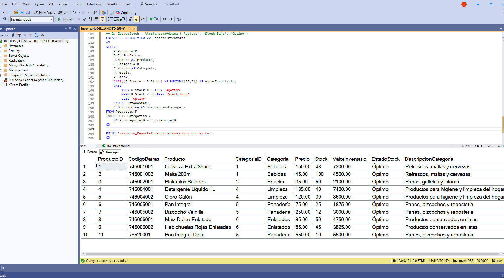
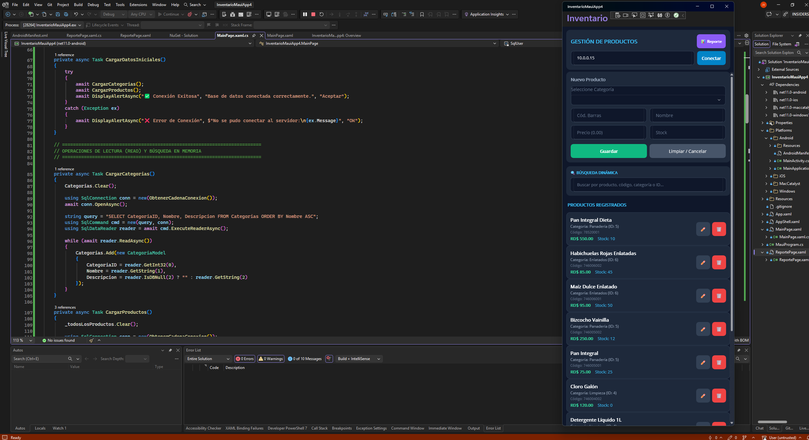
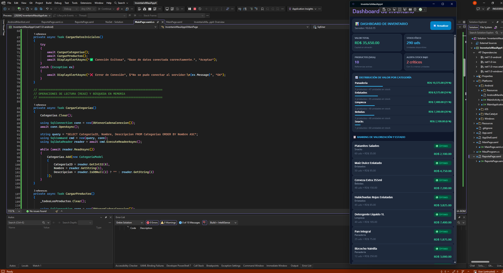

# ⚡ SISTEMA DE INVENTARIO .NET MAUI + SQL SERVER + DASHBOARD BI

<div align="center">


### 🏭 Manual Maestro de Ingeniería de Software: Arquitectura Multiplataforma, CRUD Operativo, Conectividad TCP/IP 1433 y Dashboard Analítico Semafórico en .NET MAUI (.NET 11 / 10 / 9) con Microsoft SQL Server

[](https://dotnet.microsoft.com/en-us/apps/maui)
[](https://learn.microsoft.com/es-es/dotnet/csharp/)
[](https://www.microsoft.com/es-es/sql-server/)
[](https://learn.microsoft.com/es-es/windows/apps/winui/winui3/)
[](https://developer.android.com/)
[](https://github.com/JUANCITOPENA)

</div>

---

## 📸 GALERÍA Y CAPTURAS EN VIVO DEL SISTEMA

| 📱 01. Aplicación Móvil en Android | 💻 02. Gestión CRUD en Windows Machine | 📊 03. Dashboard y Semáforo de Stock |
| :---: | :---: | :---: |
|  |  |  |
| **Navegación táctil nativa**, conexión por IP de red local y selector desplegable de categorías. | **Operaciones directas CRUD**, creación, edición en vivo, búsqueda reactiva y borrado seguro. | **KPIs financieros**, barras por categoría y ranking de mayor a menor con semáforo 🟢 🟡 🔴. |

---

## 📑 TABLA DE CONTENIDOS

1. [Visión General del Proyecto](#-1-visión-general-del-proyecto)
2. [Arquitectura del Sistema y Tecnologías](#-2-arquitectura-del-sistema-y-tecnologías)
3. [Requisitos Previos y Enlaces Oficiales](#-3-requisitos-previos-y-enlaces-oficiales)
4. [Configuración Integral de SQL Server](#-4-configuración-integral-de-sql-server)
   - 4.1. [Descargas e Instalación](#41-descargas-e-instalación-express--ssms)
   - 4.2. [Inicio de Sesión y Autenticación Mixta](#42-inicio-de-sesión-manual-y-modo-mixto)
   - 4.3. [Creación de Usuario y Permisos Totales](#43-creación-del-login-juancito-y-permisos)
   - 4.4. [Diagramas de Base de Datos en SSMS](#44-creación-de-diagramas-en-ssms)
   - 4.5. [Conexiones Remotas, TCP/IP 1433 y Firewall](#45-conexiones-remotas-tcpip-1433-y-firewall)
   - 4.6. [Fundamentos Relacionales, CRUD y Vistas](#46-fundamentos-relacionales-crud-y-vistas)
5. [Script T-SQL Canónico Completo](#-5-script-t-sql-canónico-completo)
6. [Configuración de .NET MAUI](#-6-configuración-de-net-maui)
   - 6.1. [Driver Oficial Microsoft.Data.SqlClient](#61-driver-oficial-microsoftdatasqlclient)
   - 6.2. [Permisos y Cleartext en AndroidManifest.xml](#62-permisos-y-cleartext-en-androidmanifestxml)
   - 6.3. [Guía Rápida de Direcciones IP](#63-guía-rápida-de-direcciones-ip)
7. [Pantallas y Lógica de Negocio](#-7-pantallas-y-lógica-de-negocio)
   - 7.1. [MainPage: Gestión Operativa CRUD](#71-mainpage-gestión-operativa-crud)
   - 7.2. [ReportePage: Dashboard Analítico con Semáforo](#72-reportepage-dashboard-analítico-con-semáforo)
8. [Compilación, Pruebas y Despliegue](#-8-compilación-pruebas-y-despliegue)
9. [Presentación del Autor & Footer Oficial](#-9-presentación-del-autor--footer-oficial)

---

## 🎯 1. VISIÓN GENERAL DEL PROYECTO

Este proyecto resuelve el desafío de conectar aplicaciones móviles y de escritorio modernas construidas con **.NET MAUI** directamente a bases de datos relacionales empresariales **Microsoft SQL Server**, eliminando cuellos de botella de red y proporcionando:

* **Gestión Operativa Completa (CRUD):** Registro, modificación, consulta y eliminación de artículos con integridad referencial en tiempo real.
* **Dashboard Ejecutivo de Alto Impacto (BI):** Cálculo automático de capital inmovilizado, existencias totales, concentración por categoría y semáforo de inventario crítico.
* **Ordenamiento de Mayor a Menor Existencia:** Presentación jerárquica de inventario basada en la vista oficial `vw_ReporteInventario`.
* **Semáforo Cromático Condicional:**
  * 🟢 **ÓPTIMO:** Existencia > 5 unidades (`#10B981` / fondo `#064E3B`).
  * 🟡 **STOCK BAJO:** Existencia entre 1 y 5 unidades (`#F59E0B` / fondo `#451A03`).
  * 🔴 **AGOTADO:** Existencia = 0 unidades (`#EF4444` / fondo `#450A0A`).

---

## 🏗️ 2. ARQUITECTURA DEL SISTEMA Y TECNOLOGÍAS

El sistema adopta una arquitectura limpia y desacoplada estructurada en 3 niveles:

```
┌────────────────────────────────────────────────────────┐
│               CAPA DE PRESENTACIÓN (UI)                │
│   .NET MAUI (XAML + C# 13) Multiplataforma             │
│   ├── MainPage.xaml (Formulario CRUD + Filtros)        │
│   └── ReportePage.xaml (Dashboard BI + Semáforos)      │
└──────────────────────────┬─────────────────────────────┘
                           │ ADO.NET Asíncrono (async/await)
┌──────────────────────────▼─────────────────────────────┐
│             DRIVER DE ACCESO A DATOS                   │
│   Microsoft.Data.SqlClient (v7.1.2)                    │
│   ├── Conexión Socket TCP Directa (Puerto 1433)        │
│   └── Parámetros Seguros (Prevención SQL Injection)    │
└──────────────────────────┬─────────────────────────────┘
                           │ TCP/IP 1433 / Firewall Allow
┌──────────────────────────▼─────────────────────────────┐
│          MOTOR DE BASE DE DATOS EMPRESARIAL            │
│   Microsoft SQL Server 2022 (Express / Developer)      │
│   ├── Tablas Relacionales (Categorias, Productos)      │
│   ├── Claves Foráneas (FK con ON DELETE CASCADE)       │
│   └── Vista Analítica Pre-compilada:                   │
│       vw_ReporteInventario (KPIs + Alertas Semáforo)   │
└────────────────────────────────────────────────────────┘
```

---

## 📥 3. REQUISITOS PREVIOS Y ENLACES OFICIALES

Para replicar el entorno de desarrollo, asegúrate de contar con las siguientes herramientas oficiales:

| Herramienta | Versión Recomendada | Enlace Oficial de Descarga |
| :--- | :--- | :--- |
| **Microsoft SQL Server Express** | 2022 Express | [Descargar SQL Server Express](https://www.microsoft.com/es-es/sql-server/sql-server-downloads) |
| **SQL Server Management Studio** | SSMS 20.x | [Descargar SSMS Oficial](https://learn.microsoft.com/es-es/sql/ssms/download-sql-server-management-studio-ssms) |
| **Visual Studio** | 2022 o 2026 | [Descargar Visual Studio](https://visualstudio.microsoft.com/es/) *(Carga de trabajo: Desarrollo con .NET MAUI)* |
| **.NET SDK** | .NET 10.0 / 11.0 / 9.0 | [Descargar .NET SDK](https://dotnet.microsoft.com/es-es/download) |

---

## 🗄️ 4. CONFIGURACIÓN INTEGRAL DE SQL SERVER

### 4.1. Descargas e Instalación (Express & SSMS)
1. Ejecuta el instalador de **SQL Server Express**, selecciona el tipo de instalación **Básica**, acepta la licencia y permite que descargue e instale la instancia predeterminada `SQLEXPRESS`.
2. Ejecuta el instalador de **SSMS**, haz clic en **Instalar**, espera que finalice y reinicia el equipo si el asistente lo solicita.

### 4.2. Inicio de Sesión Manual y Modo Mixto
1. Abre **SSMS**, selecciona `Server type: Database Engine`, en `Server name` escribe `.` o `localhost` o `.\SQLEXPRESS`, y pulsa `Connect` con **Windows Authentication**.
2. Haz clic derecho sobre el nodo del servidor en el *Object Explorer* &rarr; **Properties** &rarr; página **Security** &rarr; selecciona **SQL Server and Windows Authentication mode** (Modo Mixto) &rarr; **OK**.
3. Haz clic derecho en el servidor &rarr; **Restart** (Reiniciar) para aplicar los cambios.

### 4.3. Creación del Login JUANCITO y Permisos
Ejecuta el siguiente script T-SQL para crear el usuario y concederle privilegios de administración:

```sql
USE [master];
GO
IF NOT EXISTS (SELECT name FROM sys.server_principals WHERE name = N'JUANCITO')
BEGIN
    CREATE LOGIN [JUANCITO] WITH PASSWORD = N'123456',
        DEFAULT_DATABASE = [master],
        CHECK_EXPIRATION = OFF,
        CHECK_POLICY = OFF;
END
GO
ALTER SERVER ROLE [sysadmin] ADD MEMBER [JUANCITO];
ALTER SERVER ROLE [dbcreator] ADD MEMBER [JUANCITO];
ALTER LOGIN [JUANCITO] ENABLE;
GRANT CONNECT SQL TO [JUANCITO];
GO
```

### 4.4. Creación de Diagramas en SSMS
1. Despliega `Databases` &rarr; `InventarioDB1`.
2. Clic derecho en `Database Diagrams` &rarr; si solicita habilitar objetos de soporte, pulsa **Yes**.
3. Clic derecho en `Database Diagrams` &rarr; `New Database Diagram` &rarr; Agrega las tablas `Categorias` y `Productos`.
4. Observa la relación gráfica con la **llave dorada** en `Categorias.CategoriaID` (PK) y el **símbolo infinito (`∞`)** en `Productos.CategoriaID` (FK).
5. Presiona `Ctrl + S`, nómbralo `Diagrama_Inventario` y guárdalo.

### 4.5. Conexiones Remotas, TCP/IP 1433 y Firewall
1. En SSMS &rarr; Clic derecho en servidor &rarr; `Properties` &rarr; `Connections` &rarr; marca **Allow remote connections to this server**.
2. Abre **SQL Server Configuration Manager** (`SQLServerManager16.msc`).
   - Ve a `SQL Server Network Configuration` &rarr; `Protocols for SQLEXPRESS` (o `MSSQLSERVER`).
   - Clic derecho en `TCP/IP` &rarr; **Enable**.
   - Doble clic en `TCP/IP` &rarr; pestaña `IP Addresses` &rarr; sección **IPAll**:
     * Borra el contenido de **TCP Dynamic Ports** (déjalo vacío).
     * En **TCP Port** escribe `1433`.
     * Pulsa **Apply** y **OK**.
3. Abre **PowerShell como Administrador** y ejecuta:

```powershell
# 1. Reglas de Firewall para TCP 1433 y UDP 1434
New-NetFirewallRule -DisplayName "SQL Server Port 1433 TCP" -Direction Inbound -LocalPort 1433 -Protocol TCP -Action Allow
New-NetFirewallRule -DisplayName "SQL Server Port 1433 UDP" -Direction Inbound -LocalPort 1433 -Protocol UDP -Action Allow
New-NetFirewallRule -DisplayName "SQL Server Browser Port 1434 UDP" -Direction Inbound -LocalPort 1434 -Protocol UDP -Action Allow

# 2. Habilitar servicio SQL Server Browser
Set-Service -Name "SQLBrowser" -StartupType Automatic
Start-Service -Name "SQLBrowser"

# 3. Reiniciar motor de SQL Server
Restart-Service -Name "MSSQLSERVER" -Force # O 'MSSQL$SQLEXPRESS'

# 4. Ver tu IPv4 local
ipconfig | findstr /i "IPv4"
```

### 4.6. Fundamentos Relacionales, CRUD y Vistas
* **Tabla:** Entidad estructurada en filas (registros) y columnas tipadas (`INT`, `NVARCHAR`, `DECIMAL`).
* **Primary Key (PK):** Identificador unívoco auto-incremental (`IDENTITY(1,1)`).
* **Foreign Key (FK):** Vinculación referencial con eliminación en cascada (`ON DELETE CASCADE`).
* **CRUD:** **C**reate (`INSERT INTO`), **R**ead (`SELECT`), **U**pdate (`UPDATE`), **D**elete (`DELETE`).
* **Vista (`VIEW`):** Consulta virtual pre-compilada que une tablas mediante `INNER JOIN`, calcula métricas en tiempo real (`ValorInventario = Precio * Stock`) y semaforiza el estado (`Agotado`, `Stock Bajo`, `Óptimo`) sin duplicar espacio en disco.

---

## 📜 5. SCRIPT T-SQL CANÓNICO COMPLETO

```sql
-- =============================================================================
-- BASE DE DATOS Y ESTRUCTURA RELACIONAL
-- =============================================================================
USE [master];
GO

IF NOT EXISTS (SELECT name FROM sys.databases WHERE name = N'InventarioDB1')
BEGIN
    CREATE DATABASE InventarioDB1;
END
GO

USE InventarioDB1;
GO

-- 1. Tabla Maestra de Categorías
IF NOT EXISTS (SELECT * FROM sys.tables WHERE name = N'Categorias')
BEGIN
    CREATE TABLE Categorias (
        CategoriaID INT IDENTITY(1,1) NOT NULL,
        Nombre NVARCHAR(100) NOT NULL,
        Descripcion NVARCHAR(250) NULL,
        CONSTRAINT PK_Categorias PRIMARY KEY CLUSTERED (CategoriaID)
    );
END
GO

-- 2. Tabla Detalle de Productos
IF NOT EXISTS (SELECT * FROM sys.tables WHERE name = N'Productos')
BEGIN
    CREATE TABLE Productos (
        ProductoID INT IDENTITY(1,1) NOT NULL,
        CategoriaID INT NOT NULL,
        CodigoBarras NVARCHAR(50) NOT NULL UNIQUE,
        Nombre NVARCHAR(120) NOT NULL,
        Precio DECIMAL(18,2) NOT NULL DEFAULT 0.00,
        Stock INT NOT NULL DEFAULT 0,
        CONSTRAINT PK_Productos PRIMARY KEY CLUSTERED (ProductoID),
        CONSTRAINT FK_Productos_Categorias FOREIGN KEY (CategoriaID)
            REFERENCES Categorias(CategoriaID)
            ON DELETE CASCADE
            ON UPDATE CASCADE
    );
END
GO

-- 3. Datos Semilla de Prueba
IF NOT EXISTS (SELECT TOP 1 1 FROM Categorias)
BEGIN
    INSERT INTO Categorias (Nombre, Descripcion) VALUES
    ('Bebidas', 'Refrescos, maltas, jugos y cervezas nacionales'),
    ('Snacks', 'Papas fritas, galletas, platanitos y frutos secos'),
    ('Lácteos', 'Leches pasteurizadas, quesos crema y yogures'),
    ('Limpieza', 'Detergentes líquidos, cloro, desinfectantes y jabones'),
    ('Panadería', 'Panes de agua, pan sobao, bizcochos y repostería'),
    ('Enlatados', 'Maíz dulce, habichuelas, sardinas y atún en conserva');
END
GO

IF NOT EXISTS (SELECT TOP 1 1 FROM Productos)
BEGIN
    INSERT INTO Productos (CategoriaID, CodigoBarras, Nombre, Precio, Stock) VALUES
    (1, '746001001', 'Cerveza Extra 355ml', 150.00, 48),
    (1, '746001002', 'Malta Morena 200ml', 45.00, 100),
    (1, '746001003', 'Refresco Cola 500ml', 50.00, 75),
    (2, '746002001', 'Platanitos Salados 45g', 35.00, 60),
    (2, '746002002', 'Galletas Dulces Vainilla', 40.00, 25),
    (3, '746003001', 'Queso Cheddar 1lb', 280.00, 15),
    (4, '746004001', 'Detergente Líquido 1L', 185.00, 40),
    (4, '746004002', 'Cloro Concentrado Galón', 120.00, 30),
    (5, '746005001', 'Pan Integral de Molde', 75.00, 5),   -- Alerta: Stock Bajo (<= 5)
    (5, '746005002', 'Bizcocho Vainilla Mini', 250.00, 12),
    (6, '746006001', 'Maíz Dulce Enlatado 400g', 95.00, 50),
    (6, '746006002', 'Habichuelas Rojas 400g', 85.00, 0);    -- Alerta: Agotado (= 0)
END
GO

-- 4. Vista Analítica para Dashboards y Reportes
CREATE OR ALTER VIEW vw_ReporteInventario
AS
SELECT
    P.ProductoID,
    P.CodigoBarras,
    P.Nombre AS Producto,
    C.CategoriaID,
    C.Nombre AS Categoria,
    P.Precio,
    P.Stock,
    CAST((P.Precio * P.Stock) AS DECIMAL(18,2)) AS ValorInventario,
    CASE
        WHEN P.Stock = 0 THEN 'Agotado'
        WHEN P.Stock <= 5 THEN 'Stock Bajo'
        ELSE 'Óptimo'
    END AS EstadoStock,
    C.Descripcion AS DescripcionCategoria
FROM Productos P
INNER JOIN Categorias C
    ON P.CategoriaID = C.CategoriaID;
GO

-- Asignar permisos completos al usuario JUANCITO
IF NOT EXISTS (SELECT name FROM sys.database_principals WHERE name = N'JUANCITO')
BEGIN
    CREATE USER [JUANCITO] FOR LOGIN [JUANCITO];
END
GO
ALTER ROLE [db_owner] ADD MEMBER [JUANCITO];
GO

-- Consulta de prueba ordenada de mayor a menor stock
SELECT * FROM vw_ReporteInventario ORDER BY Stock DESC, ValorInventario DESC;
GO
```

---

## 📱 6. CONFIGURACIÓN DE .NET MAUI

### 6.1. Driver Oficial Microsoft.Data.SqlClient
Instala el paquete NuGet desde Visual Studio o la terminal:
```bash
dotnet add package Microsoft.Data.SqlClient
```

### 6.2. Permisos y Cleartext en AndroidManifest.xml
En `Platforms/Android/AndroidManifest.xml`:

```xml
<?xml version="1.0" encoding="utf-8"?>
<manifest xmlns:android="http://schemas.android.com/apk/res/android">

    <!-- 1. Permisos de Red obligatorios -->
    <uses-permission android:name="android.permission.INTERNET" />
    <uses-permission android:name="android.permission.ACCESS_NETWORK_STATE" />

    <!-- 2. usesCleartextTraffic="true" OBLIGATORIO para sockets TCP locales -->
    <application
        android:allowBackup="true"
        android:icon="@mipmap/appicon"
        android:roundIcon="@mipmap/appicon_round"
        android:supportsRtl="true"
        android:usesCleartextTraffic="true">
    </application>

</manifest>
```

### 6.3. Guía Rápida de Direcciones IP
* **Emulador Android de Visual Studio:** Usa la IP virtual especial `10.0.2.2` (apunta al `localhost` del host de Windows).
* **Teléfono Físico Android por Wi-Fi o USB:** Usa la IP privada de tu PC en la red local (ejemplo: `10.0.0.15`, `192.168.1.X` o `172.16.0.x`).
* **Windows Machine:** Usa `localhost`, `127.0.0.1` o la IP local.

---

## 🎨 7. PANTALLAS Y LÓGICA DE NEGOCIO

### 7.1. MainPage: Gestión Operativa CRUD
* **Interfaz Declarativa XAML:** Tarjeta superior con campo de IP del servidor y botón de conexión rápida; formulario interactivo con `Picker` de Categorías, entradas numéricas validadas, botón de guardado/actualización, barra de búsqueda reactiva y lista `CollectionView`.
* **Lógica C# ADO.NET:** Conexión con `SqlConnection`, consultas parametrizadas con `SqlCommand` (`@Nombre`, `@Precio`, `@Stock`), navegación asíncrona hacia `ReportePage` mediante `await Navigation.PushAsync(new ReportePage(_serverIp))` y alertas de confirmación con `await DisplayAlertAsync(...)`.

### 7.2. ReportePage: Dashboard Analítico con Semáforo
* **Consulta Directa a la Vista:**
  ```sql
  SELECT ProductoID, CodigoBarras, Producto, CategoriaID, Categoria, 
         Precio, Stock, ValorInventario, EstadoStock
  FROM vw_ReporteInventario
  ORDER BY Stock DESC, ValorInventario DESC;
  ```
* **Visuales Clave:**
  1. **Cuadrícula de KPIs 2x2:** Valor Total (`LblValorTotal`), Stock Físico (`LblTotalUnidades`), SKUs (`LblTotalProductos`) y Alertas Semáforo (`LblStockBajo`).
  2. **Gráfico de Barras Nativo:** Distribución porcentual por familia de productos mediante `ProgressBar`.
  3. **Ranking de Inventario de Mayor a Menor:** Tarjetas individuales con borde reactivo (`Stroke="{Binding ColorEstadoBorde}"`) y badges semafóricos (🟢 `ÓPTIMO`, 🟡 `STOCK BAJO`, 🔴 `AGOTADO`).

---

## 🚀 8. COMPILACIÓN, PRUEBAS Y DESPLIEGUE

Para compilar y ejecutar en Windows o Android desde la consola de .NET CLI:

```bash
# Compilación para Windows Machine (WinUI 3)
dotnet build -f net11.0-windows10.0.19041.0

# Compilación para Android (Dispositivo o Emulador)
dotnet build -f net11.0-android

# Ejecución directa en Windows
dotnet run -f net11.0-windows10.0.19041.0
```

---

<!-- =========================================================================
     SECCIÓN: BIOGRAFÍA PROFESIONAL, FILOSOFÍA & STACK TÉCNICO (ING. JUANCITO PEÑA)
========================================================================== -->

## 👨‍💻 9. PRESENTACIÓN DEL AUTOR & FOOTER OFICIAL

<div align="center">


### Ing. Juancito Peña Vizcaíno
`Data Analyst` • `Full Stack Dev` • `AI & API Expert` • `Líder I+D+i`

</div>

**Ingeniero en Sistemas y Computación** con Postgrado en **Ingeniería de Software** y Maestría en **Sistemas Mención Gerencial** (*Universidad Dominicana O&M*). Con más de **15 años de trayectoria profesional**, transforma problemas de alta complejidad en soluciones escalables. Durante el último año, ha centrado su labor en **I+D+i (Investigación, Desarrollo e Innovación)**, explorando arquitecturas de **IA Generativa (RAG / LLMs)**, integración de agentes autónomos con bases de datos y orquestación de APIs empresariales.

🔬 **Filosofía Técnica:** Su motor es el aprendizaje a través de los retos: apasionado por los *casos de uso reales*, las **pruebas técnicas rigurosas**, la investigación profunda y el diseño de soluciones directas a problemas de ingeniería.  
🎓 Como **docente universitario** y creador del canal educativo **[@JuancitoDevV](https://www.youtube.com/@JuancitoDevV)**, comparte este conocimiento práctico mediante ejercicios y proyectos de código abierto para acercar la tecnología a problemas reales. 🚀

---

### 🛠️ Ecosistema de Tecnologías Dominadas

* **🖥️ Frontend & Web:** HTML5, CSS3, JavaScript, React, Next.js, Material 3, Tailwind CSS, Bootstrap.
* **⚙️ Backend & Multiplataforma:** C# 13, .NET MAUI, ASP.NET Core Web APIs, Python, PHP, Dapper, Entity Framework Core.
* **📊 Data Analytics & Bases de Datos:** Microsoft SQL Server (T-SQL, SSMS, Configuration Manager), PostgreSQL, MySQL, Power BI (DAX, VertiPaq, Star Schema, PBIP/TMDL).
* **🤖 IA, APIs & Despliegue (I+D+i):** APIs RESTful, IA Generativa (RAG, LLMs, Gemini Pro), Agentes Autónomos, Git, GitHub Actions CI/CD, Vercel.

---

### 🌐 Canales Oficiales & Redes

<div align="center">

[](https://www.linkedin.com/in/juancitope%C3%B1a/)
[](https://www.youtube.com/@JuancitoDevV)
[](https://github.com/JUANCITOPENA)
[](https://twitter.com/JuancitoPenaV)
[](mailto:juancito.pena@gmail.com)

</div>

---

<div align="center">

**PROYECTO OFICIAL JPV — Sistemas, Datos & Arquitectura de Software**  
*Plataforma de grado industrial desarrollada bajo estándares de alto rendimiento, accesibilidad universal y diseño limpio.*  
*Diseñado, desarrollado y certificado por el **Ing. Juancito Peña Vizcaíno**. Todos los derechos reservados.*

[⬆ Volver al Inicio](#-sistema-de-inventario-net-maui--sql-server--dashboard-bi)

</div>
